# Galeria — 10 casos × 2 modos

Gerado automaticamente em 2026-11-16T10:58:41. Render: Blender 5.0.1 headless,
Cycles CPU, **câmera/luz idênticas para todos** (ângulo A = 3/4 frontal 35°/25°,
ângulo B = 3/4 traseiro 145°/15°). Malha CRUDA do gerador (sem reparo).

## trex_figurine — miniatura

| input | TRELLIS A / B | TripoSR A / B |
|---|---|---|
 `MIT` | `trellis: ERRO` | 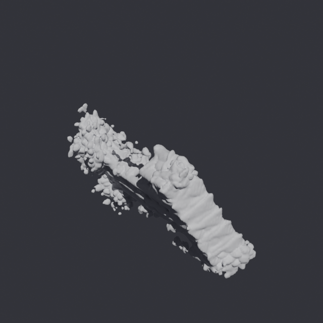 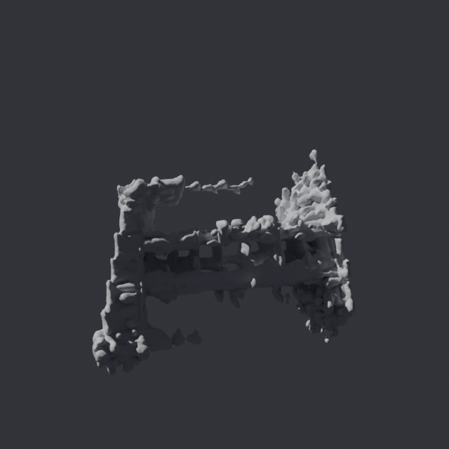 `t=18.8s · 4385MiB · 70097v · manifold True→True` |

## humanoide_dragonborn — miniatura humanoide (caso de uso do Estúdio de Pose — Fase 3)

| input | TRELLIS A / B | TripoSR A / B |
|---|---|---|
 `MIT` | `trellis: ERRO` | 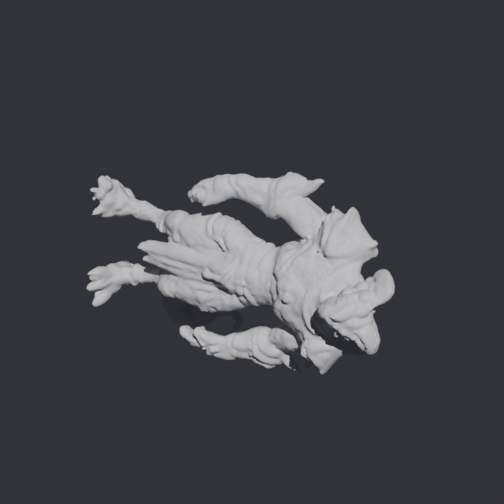 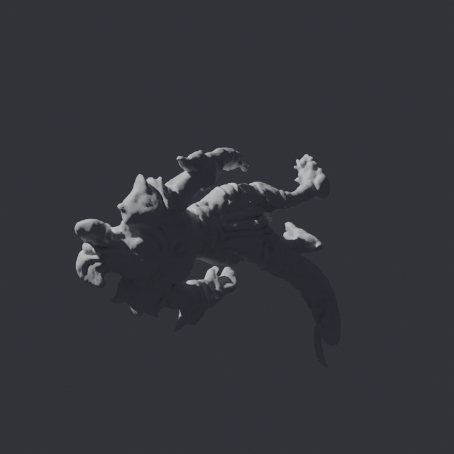 `t=14.7s · 4385MiB · 45976v · manifold True→True` |

## criatura_dragao — criatura detalhada

| input | TRELLIS A / B | TripoSR A / B |
|---|---|---|
 `MIT` | `trellis: ERRO` | 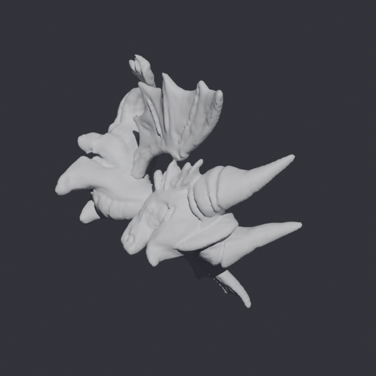 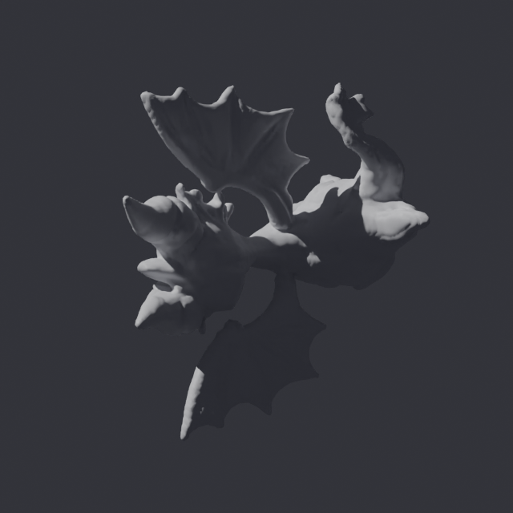 `t=13.5s · 4385MiB · 53039v · manifold True→True` |

## estrutura_castelo — estrutura

| input | TRELLIS A / B | TripoSR A / B |
|---|---|---|
 `MIT` | `trellis: ERRO` | 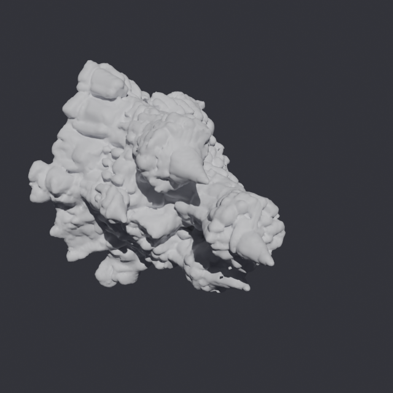 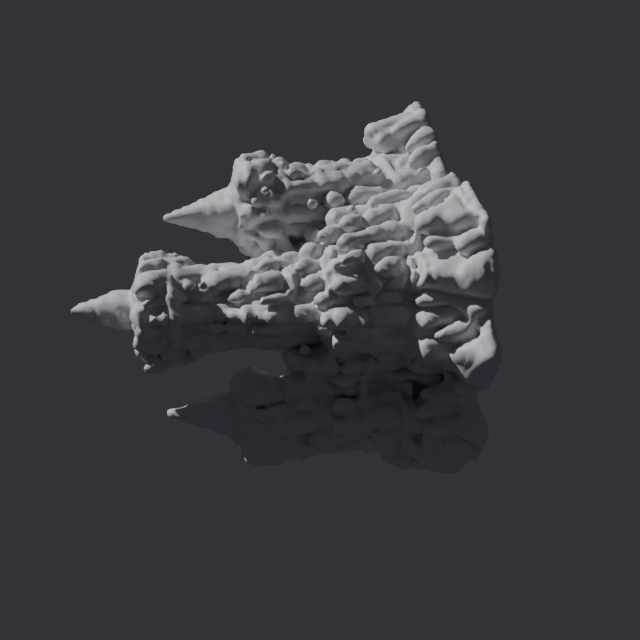 `t=14.0s · 4385MiB · 67180v · manifold False→False` |

## estrutura_piramide — estrutura geométrica simples

| input | TRELLIS A / B | TripoSR A / B |
|---|---|---|
 `MIT` | `trellis: ERRO` | 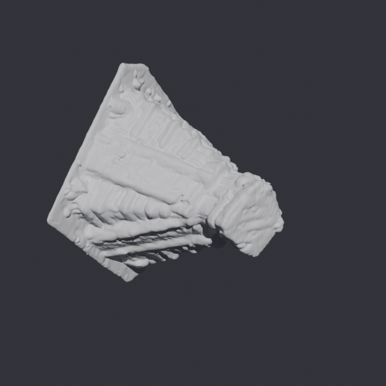 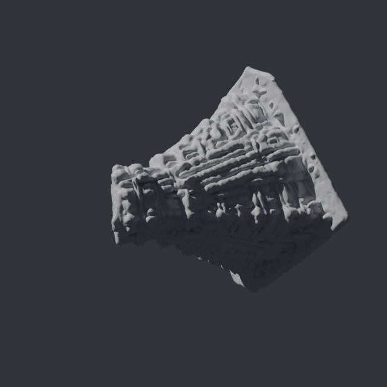 `t=13.5s · 4385MiB · 98443v · manifold True→True` |

## prop_caixote — prop simples

| input | TRELLIS A / B | TripoSR A / B |
|---|---|---|
 `MIT` | `trellis: ERRO` | 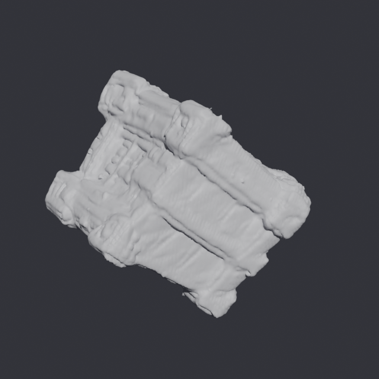 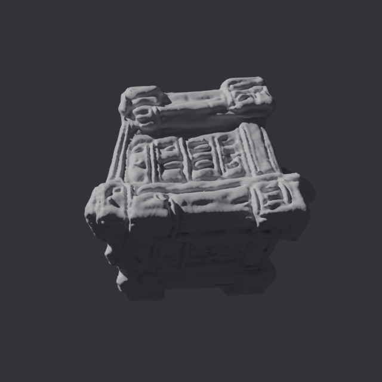 `t=14.1s · 4385MiB · 96609v · manifold True→True` |

## robo_caranguejo — hard surface

| input | TRELLIS A / B | TripoSR A / B |
|---|---|---|
 `MIT` | `trellis: ERRO` | 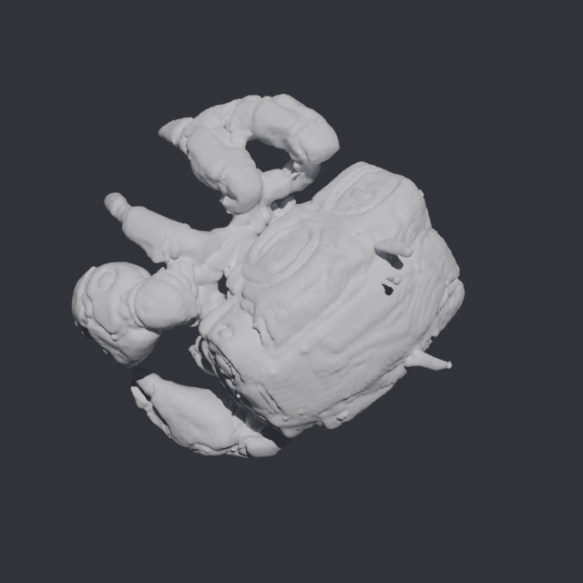 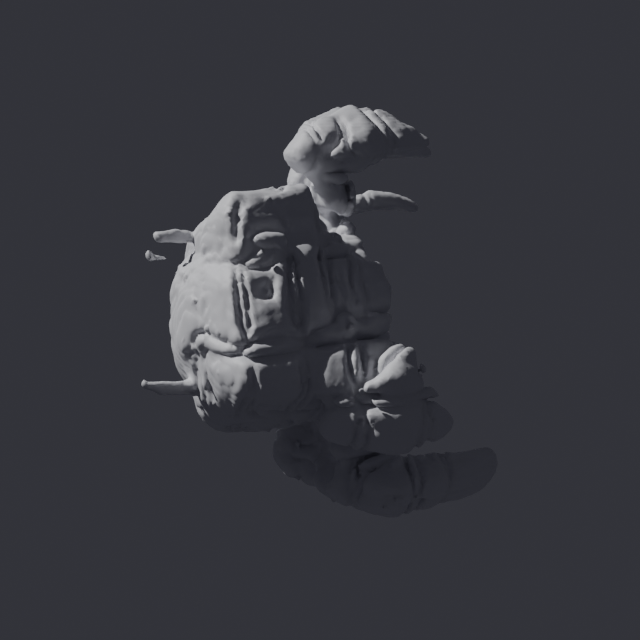 `t=13.4s · 4385MiB · 107770v · manifold True→True` |

## local_caneca — peça funcional (uso real do dono)

| input | TRELLIS A / B | TripoSR A / B |
|---|---|---|
 `CC0` | `trellis: ERRO` | 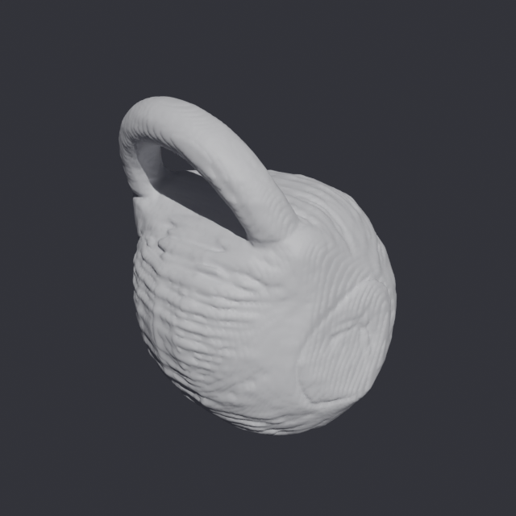  `t=27.1s · 4385MiB · 72043v · manifold True→True` |

## local_engrenagem — peça funcional mecânica

| input | TRELLIS A / B | TripoSR A / B |
|---|---|---|
 `CC0` | `trellis: ERRO` | 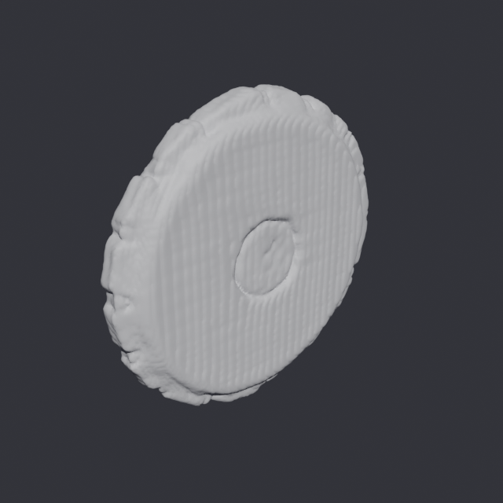 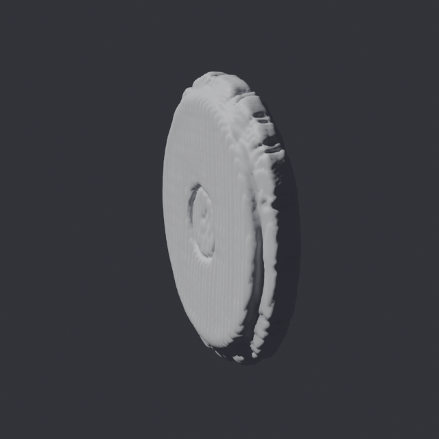 `t=31.0s · 4385MiB · 48964v · manifold True→True` |

## local_gancho — peça funcional (impressão prática)

| input | TRELLIS A / B | TripoSR A / B |
|---|---|---|
 `CC0` | `trellis: ERRO` | 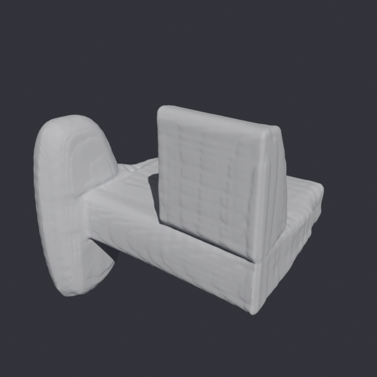 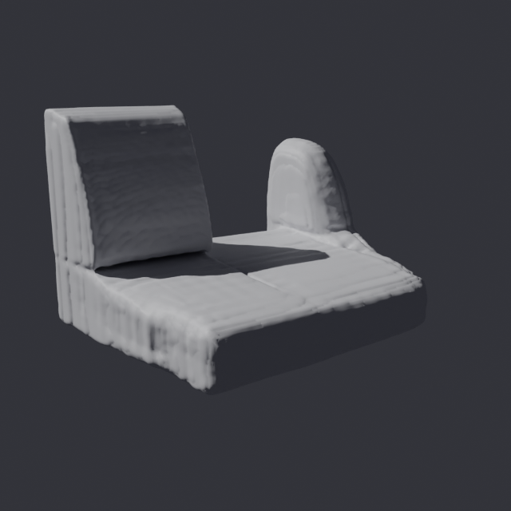 `t=31.1s · 4385MiB · 80192v · manifold True→True` |

---
Votação do dono: 👍/👎 por caso, por modo — registrada depois em ADR-005 (default mode).

